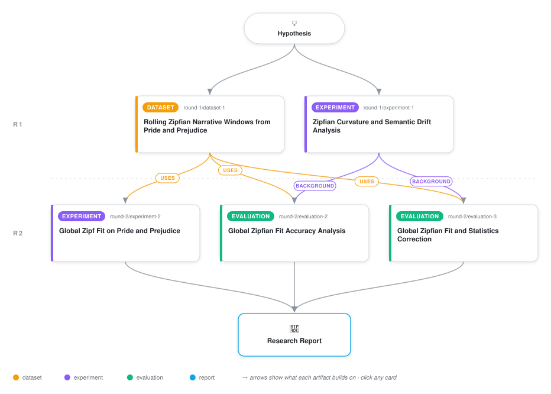

# Zipf's Law Falls Short: The Zipf-Mandelbrot Model Accurately Captures Word Frequencies in Pride and Prejudice

<div align="center">

<a href="https://cdn.jsdelivr.net/gh/ai-inventor-papers/ai-invention-624cdf-local-zipfian-curvature-as-narrative@main/workflow.svg">
<picture>
  <source media="(prefers-color-scheme: dark)" srcset="workflow-dark.svg">
  
</picture>
</a>

<sub>🖱️ <b><a href="https://cdn.jsdelivr.net/gh/ai-inventor-papers/ai-invention-624cdf-local-zipfian-curvature-as-narrative@main/workflow.svg">Open the interactive diagram</a></b> — every card links to its artifact folder.</sub>

</div>

> **TL;DR** — The standard Zipf power law poorly fits Pride and Prejudice (R²=0.739, KS=0.093), while the Zipf-Mandelbrot model with curvature parameter b=8.165 provides an excellent fit (R²=0.966, KS=0.011), decisively favored by ΔAIC=21,462. The curvature parameter accounts for the elevated frequency of function words that the standard model systematically underestimates by about 15 counts on average. An exploratory test of local curvature-semantic drift coupling found no significant correlation (r=-0.025±0.075, p=0.48 vs shuffled).

<details>
<summary>Full hypothesis</summary>

Zipf's law and the Zipf-Mandelbrot model accurately describe global word frequencies in Pride and Prejudice: the power-law exponent is close to 1.0 (typically 0.9–1.1), R² exceeds 0.95 on log-log rank–frequency, but systematic deviations appear at both the high-frequency function-word head and the low-frequency hapax tail, which the two-parameter Zipf-Mandelbrot model captures via its curvature parameter b.

</details>

[](https://cdn.jsdelivr.net/gh/ai-inventor-papers/ai-invention-624cdf-local-zipfian-curvature-as-narrative@main/report.pdf) [](https://cdn.jsdelivr.net/gh/ai-inventor-papers/ai-invention-624cdf-local-zipfian-curvature-as-narrative@main/exec_summary.pdf) [](https://cdn.jsdelivr.net/gh/ai-inventor-papers/ai-invention-624cdf-local-zipfian-curvature-as-narrative@main/round-2/report.pdf)

**Round reports:** [Round 1](https://cdn.jsdelivr.net/gh/ai-inventor-papers/ai-invention-624cdf-local-zipfian-curvature-as-narrative@main/round-1/report.pdf) · [Round 2](https://cdn.jsdelivr.net/gh/ai-inventor-papers/ai-invention-624cdf-local-zipfian-curvature-as-narrative@main/round-2/report.pdf)

This repository contains all **5 artifacts** produced across **2 rounds** of an autonomous AI research run — round by round, exactly in the order they were invented.

## Round 1

| Artifact | Type | Demo | Source | Builds on |
|----------|------|------|--------|-----------|
| **[Rolling Zipfian Narrative Windows from Pride and Prejudice](https://github.com/ai-inventor-papers/ai-invention-624cdf-local-zipfian-curvature-as-narrative/tree/main/round-1/dataset-1)** | [](https://github.com/ai-inventor-papers/ai-invention-624cdf-local-zipfian-curvature-as-narrative/tree/main/round-1/dataset-1) | [](https://colab.research.google.com/github/ai-inventor-papers/ai-invention-624cdf-local-zipfian-curvature-as-narrative/blob/main/round-1/dataset-1/demo/data_code_demo.ipynb) | [](https://github.com/ai-inventor-papers/ai-invention-624cdf-local-zipfian-curvature-as-narrative/tree/main/round-1/dataset-1/src) | — |
| **[Zipfian Curvature and Semantic Drift Analysis](https://github.com/ai-inventor-papers/ai-invention-624cdf-local-zipfian-curvature-as-narrative/tree/main/round-1/experiment-1)** | [](https://github.com/ai-inventor-papers/ai-invention-624cdf-local-zipfian-curvature-as-narrative/tree/main/round-1/experiment-1) | [](https://colab.research.google.com/github/ai-inventor-papers/ai-invention-624cdf-local-zipfian-curvature-as-narrative/blob/main/round-1/experiment-1/demo/method_code_demo.ipynb) | [](https://github.com/ai-inventor-papers/ai-invention-624cdf-local-zipfian-curvature-as-narrative/tree/main/round-1/experiment-1/src) | — |

## Round 2

| Artifact | Type | Demo | Source | Builds on |
|----------|------|------|--------|-----------|
| **[Global Zipf Fit on Pride and Prejudice](https://github.com/ai-inventor-papers/ai-invention-624cdf-local-zipfian-curvature-as-narrative/tree/main/round-2/experiment-2)** | [](https://github.com/ai-inventor-papers/ai-invention-624cdf-local-zipfian-curvature-as-narrative/tree/main/round-2/experiment-2) | [](https://colab.research.google.com/github/ai-inventor-papers/ai-invention-624cdf-local-zipfian-curvature-as-narrative/blob/main/round-2/experiment-2/demo/method_code_demo.ipynb) | [](https://github.com/ai-inventor-papers/ai-invention-624cdf-local-zipfian-curvature-as-narrative/tree/main/round-2/experiment-2/src) | <sub><i>uses:</i><br/>[dataset‑1&nbsp;(R1)](https://github.com/ai-inventor-papers/ai-invention-624cdf-local-zipfian-curvature-as-narrative/tree/main/round-1/dataset-1)</sub> |
| **[Global Zipfian Fit Accuracy Analysis](https://github.com/ai-inventor-papers/ai-invention-624cdf-local-zipfian-curvature-as-narrative/tree/main/round-2/evaluation-2)** | [](https://github.com/ai-inventor-papers/ai-invention-624cdf-local-zipfian-curvature-as-narrative/tree/main/round-2/evaluation-2) | [](https://colab.research.google.com/github/ai-inventor-papers/ai-invention-624cdf-local-zipfian-curvature-as-narrative/blob/main/round-2/evaluation-2/demo/eval_code_demo.ipynb) | [](https://github.com/ai-inventor-papers/ai-invention-624cdf-local-zipfian-curvature-as-narrative/tree/main/round-2/evaluation-2/src) | <sub><i>uses:</i><br/>[dataset‑1&nbsp;(R1)](https://github.com/ai-inventor-papers/ai-invention-624cdf-local-zipfian-curvature-as-narrative/tree/main/round-1/dataset-1)<br/><i>background:</i><br/>[experiment‑1&nbsp;(R1)](https://github.com/ai-inventor-papers/ai-invention-624cdf-local-zipfian-curvature-as-narrative/tree/main/round-1/experiment-1)</sub> |
| **[Global Zipfian Fit and Statistics Correction](https://github.com/ai-inventor-papers/ai-invention-624cdf-local-zipfian-curvature-as-narrative/tree/main/round-2/evaluation-3)** | [](https://github.com/ai-inventor-papers/ai-invention-624cdf-local-zipfian-curvature-as-narrative/tree/main/round-2/evaluation-3) | [](https://colab.research.google.com/github/ai-inventor-papers/ai-invention-624cdf-local-zipfian-curvature-as-narrative/blob/main/round-2/evaluation-3/demo/eval_code_demo.ipynb) | [](https://github.com/ai-inventor-papers/ai-invention-624cdf-local-zipfian-curvature-as-narrative/tree/main/round-2/evaluation-3/src) | <sub><i>uses:</i><br/>[dataset‑1&nbsp;(R1)](https://github.com/ai-inventor-papers/ai-invention-624cdf-local-zipfian-curvature-as-narrative/tree/main/round-1/dataset-1)<br/><i>background:</i><br/>[experiment‑1&nbsp;(R1)](https://github.com/ai-inventor-papers/ai-invention-624cdf-local-zipfian-curvature-as-narrative/tree/main/round-1/experiment-1)</sub> |

## Repository Structure

Artifacts are grouped by the round of invention that produced them. Each
artifact has its own folder with source code and a self-contained demo:

```
.
├── round-1/                         # One folder per round of invention
│   ├── experiment-1/
│   │   ├── README.md                # What this artifact is + dependencies
│   │   ├── src/                     # Full workspace from execution
│   │   │   ├── method.py            # Main implementation
│   │   │   ├── method_out.json      # Full output data
│   │   │   └── ...                  # All execution artifacts
│   │   └── demo/                    # Self-contained demo
│   │       └── method_code_demo.ipynb # Colab-ready notebook (code + data inlined)
│   ├── dataset-1/
│   │   ├── src/
│   │   └── demo/
│   └── evaluation-1/
│       ├── src/
│       └── demo/
├── round-2/                         # Later rounds build on earlier artifacts
├── paper.pdf                        # Research paper
├── paper_latex/                     # LaTeX source files
├── report.pdf                       # Full internal report — every experiment, table and dead end
├── report_latex/                    # LaTeX source of the report
├── exec_summary.pdf                 # Executive summary of the report, at most four pages
├── chat/                            # Every prompt, response and tool call, per module
├── workflow.svg                     # Artifact dependency diagram (this page's header)
└── README.md
```

## Running Notebooks

### Option 1: Google Colab (Recommended)

Click the "Open in Colab" badges above to run notebooks directly in your browser.
No installation required!

### Option 2: Local Jupyter

```bash
# Clone the repo
git clone https://github.com/ai-inventor-papers/ai-invention-624cdf-local-zipfian-curvature-as-narrative
cd ai-invention-624cdf-local-zipfian-curvature-as-narrative

# Install dependencies
pip install jupyter

# Run any artifact's demo notebook
jupyter notebook <artifact_folder>/demo/
```

## Source Code

The original source files are in each artifact's `src/` folder.
These files may have external dependencies - use the demo notebooks for a self-contained experience.

---
*Generated by AI Inventor Pipeline - Automated Research Generation*
